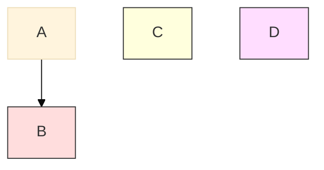

# 机器学习总结
概念：

| 术语 | 常见说法 | 真正含义 | 公式  |
|------|----------|---------|-----|
| 模型 | "AI" | 具有可学习参数的数学函数，将输入映射到输出 |     |
| 训练 | "教 AI" | 运行优化算法调整模型参数，使预测匹配已知输出 |     |
| 特征 | "输入列" | 模型用来做预测的数据的可测量属性 |     |
| 标签 | "答案" | 训练样本的已知输出，用于计算误差信号 |     |
| 超参数 | "你调整的设置" | 训练前设置的参数，控制学习过程（学习率、层数） |     |
| 损失函数 | "模型错多少" | 测量预测与实际输出差距的函数，训练试图最小化它 |     |
| 过拟合 | "它记住了测试" | 模型学习了训练特定噪声而非泛化模式，在新数据上失败 |     |
| 欠拟合 | "它什么都没学到" | 模型太简单，无法捕捉数据中的真实模式 |     |
| 泛化 | "它在新数据上有效" | 模型在未训练数据上做出准确预测的能力 |     |
| 交叉验证 | "在不同块上测试" | 反复将数据分为训练/测试折并平均结果，给出更稳健的性能估计 |     |
| 正则化 | "保持权重小" | 在损失函数中添加惩罚项，阻止过于复杂的模型 |     |
| 数据漂移 | "世界变了" | 输入数据的统计分布随时间变化，性能下降 |     |
| MSE | 均方误差，衡量预测与真实值差距的平方平均值 |如何衡量"尽可能接近"？|
| 梯度下降 | 迭代向损失函数最小值移动的优化算法 |
| 正规方程 | 一步求解最优参数的闭式解 |
| R² | 决定系数，模型解释的方差比例 |
| L2 正则化 | Ridge 回归，对大权重加惩罚防止过拟合 |
| 逻辑回归 | "用于分类的回归" | 线性模型后接 sigmoid 函数，输出类别概率 |
| Sigmoid 函数 | "S 曲线" | 函数 1/(1+e^(-z))，将任何实数映射到 (0, 1) 范围 |
| 二元交叉熵 | "对数损失" | 损失函数 -[y*log(p) + (1-y)*log(1-p)]，严重惩罚自信的错误预测 |
| 决策边界 | "分界线" | 模型输出概率等于 0.5 的曲面，分隔预测类别 |
| Softmax | "多分类 sigmoid" | 将分数向量转换为概率之和为 1 的函数 |
| 精确率 | "选中的有多少相关" | TP / (TP + FP)，阳性预测中实际为阳性的比例 |
| 召回率 | "相关的有多少被选中" | TP / (TP + FN)，模型正确识别的实际阳性的比例 |
| F1 分数 | "平衡准确率" | 精确率和召回率的调和平均：2*P*R / (P+R) |
| 混淆矩阵 | "错误分解" | 显示每对类别的 TP、TN、FP、FN 计数的表格 |
| 阈值 | "截断值" | 模型预测类 1 的概率值（默认 0.5，可调） |
| 独热编码 | "类别的二进制列" | 将类 k 表示为在位置 k 处为 1 其余为 0 的向量 |
| 类别交叉熵 | "多分类对数损失" | 使用独热编码标签的二元交叉熵到 k 类的扩展 |
| 决策树 | "预测的流程图" | 通过学习一系列 if/else 分裂将特征空间划分为矩形区域的模型 |
| Gini 不纯度 | "节点有多混杂" | 在节点错误分类随机样本的概率。0 = 纯，0.5 = 二元最大不纯度 |
| 熵 | "节点的无序" | 节点的信息内容。0 = 纯，1.0 = 二元最大不确定性。来自信息论 |
| 信息增益 | "分裂有多好" | 分裂后不纯度的减少。选择分裂的贪心标准 |
| 预剪枝 | "早点停止树" | 通过设置最大深度、最少样本或最小增益阈值提前停止树生长 |
| 后剪枝 | "之后修剪树" | 生长完整树，然后删除不能改善验证性能的子树 |
| Bagging | "在随机子集上训练" | 自助聚合。在有放回的不同随机样本上训练每个模型 |
| 随机森林 | "一堆树" | 决策树集成，每棵在自助样本上训练，每次分裂使用随机特征子集 |
| 特征重要性（MDI） | "哪些特征重要" | 每个特征贡献的不纯度总减少，在所有树和节点上求和 |
| 置换重要性 | "打乱并检查" | 特征值随机打乱时准确率下降。比 MDI 对噪声特征更可靠 |
| 方差减少 | "回归版信息增益" | 信息增益的回归树类比。选择减少目标方差最多的分裂 |
| 自助样本 | "有重复的随机样本" | 从原始数据集有放回地抽取的随机样本。相同大小，但有重复 |
| 支持向量 | 离决策边界最近的训练点。唯一决定超平面的点 |
| 间隔 | 决策边界与最近支持向量之间的距离。SVM 使其最大化 |
| 铰链损失 | max(0, 1 - y*f(x))。正确分类且在间隔外时为零。否则线性惩罚 |
| C 参数 | 间隔宽度和分类错误之间的权衡。大 C = 窄间隔，小 C = 宽间隔 |
| 软间隔 | 通过松弛变量允许间隔违规的 SVM 公式。处理不可分数据 |
| 核技巧 | 在高维特征空间中计算点积而不显式映射到该空间 |
| 线性核 | K(x, z) = x . z。等价于标准点积。用于线性可分数据 |
| RBF 核 | K(x, z) = exp(-gamma * x-z²)。映射到无限维。学习任何平滑边界 |
| 多项式核 | K(x, z) = (x . z + c)^d。映射到多项式组合的特征空间 |
| 对偶形式 | SVM 问题的重写，只依赖于数据点之间的点积。启用核 |
| SVR | 支持向量回归。在数据周围拟合 epsilon 管道。管道内的点损失为零 |
| 松弛变量 | xi_i：测量点违反间隔的程度。对于正确分类且在间隔外的点为零 |
| 最大间隔 | 选择使每类最近点距离最大化的超平面的原则 |
| K近邻 | 非参数算法，通过找到查询点最近的 K 个训练点来进行预测 |
| 惰性学习 | 训练时不计算，所有工作在预测时完成。KNN 是典型例子 |
| 积极学习 | 训练时做大量计算来构建紧凑模型。大多数 ML 算法都是积极的 |
| 维度灾难 | 在高维空间中，距离收敛，邻域扩展到覆盖大部分空间，使 KNN 失效 |
| KD树 | 二叉树，沿特征轴递归划分空间。低维下查询 O(log n) |
| 球树 | 嵌套超球体树。在中等维度（最高约50维）比 KD树表现更好 |
| 加权 KNN | 邻居按距离的倒数加权。近邻对预测的影响更大 |
| 特征缩放 | 将特征归一化到相近范围。对基于距离的方法（如 KNN）是必需的 |
| 多数投票 | 通过统计 K 个邻居中哪个类别最多来进行分类 |
| 暴力搜索 | 计算到每个训练点的距离。每次查询 O(n*d)。精确但大 n 时慢 |
| 近似最近邻 | 算法（HNSW、LSH、IVF）比精确搜索更快地找到近似最近点 |
| Voronoi 图 | 空间划分，每个区域包含到某个训练点比到其他任何点都更近的所有点。K=1 的 KNN 产生 Voronoi 边界 |
| 聚类 | "将相似的事物分组" | 将数据划分为子集，使组内相似度超过组间相似度，用特定距离度量衡量 |
| 质心 | "簇的中心" | 分配给簇的所有点的均值；K-Means 用它作为簇的代表 |
| 惯性 | "簇有多紧密" | 每个点到其分配质心的平方距离之和；越低越紧密 |
| 轮廓系数 | "簇分离得有多好" | 对每个点，(b - a) / max(a, b)，其中 a 是组内平均距离，b 是最近簇平均距离 |
| 核心点 | "密集区域中的点" | 在 DBSCAN 中，eps 距离内有至少 min_samples 个邻居的点 |
| EM算法 | "软 K-Means" | 期望最大化：迭代计算成员概率（E步）并更新分布参数（M步） |
| 树形图 | "簇的树" | 树状图，显示层次聚类中簇被合并的顺序和距离 |
| 异常 | "离群点" | 不符合预期模式的数据点，在 DBSCAN 中被标记为噪声，在 GMM 中概率低 |

1.当数据有空间或序列结构（图像、文本、音频）时神经网络胜出。对于平坦的特征表，树是默认选择。